# ⚡ HexBrain (海克斯智脑) · 全功能特性清单

> **面向《英雄联盟》全模式的毫秒级实时决策支持与态势感知系统**  
> 涵盖：海克斯大乱斗 3 选 1 投影 · 骰子池胜率看板 · 排位 BP 选人决策 · 全模式动态出装推演 · 峡谷防 Gank 决策雷达 · 桌面控制中心 · Web 大数据看板

---

## 目录
- [一、核心设计哲学与安全合规体系](#一核心设计哲学与安全合规体系)
- [二、全功能模块详细拆解](#二全功能模块详细拆解)
  - [1. 海克斯 3 选 1 局内视觉投影与语音推荐](#1-海克斯-3-选-1-局内视觉投影与语音推荐)
  - [2. 大乱斗选人阶段骰子英雄池胜率看板](#2-大乱斗选人阶段骰子英雄池胜率看板)
  - [3. 排位 / 匹配 BP 阶段全景决策辅助系统](#3-排位--匹配-bp-阶段全景决策辅助系统)
  - [4. 全模式动态自适应出装推荐系统](#4-全模式动态自适应出装推荐系统)
  - [5. 召唤师峡谷防 GANK 决策雷达与态势感知引擎](#5-召唤师峡谷防-gank-决策雷达与态势感知引擎)
  - [6. 桌面原生智能控制中心与安全授权体系](#6-桌面原生智能控制中心与安全授权体系)
  - [7. 现代深色 Web 大数据推演看板](#7-现代深色-web-大数据推演看板)
- [三、全局系统级快捷键矩阵](#三全局系统级快捷键矩阵)
- [四、技术架构与运行性能指标](#四技术架构与运行性能指标)

---

## 一、核心设计哲学与安全合规体系

| 指标 | HexBrain 的实现标准 | 技术机理 |
| :--- | :--- | :--- |
| **0 内存注入 / 0 封号风险** | 100% Vanguard 安全合规 | 绝不读取或写入游戏内存（0 ReadProcessMemory、0 DLL 注入），纯依赖 Windows 视觉嗅探与 Riot 官方公开接口 |
| **0 切屏 / 0 抢焦点** | 彻底不影响玩家施法与走位 | 所有置顶悬浮窗均注入 Windows 原生 `WS_EX_NOACTIVATE \| WS_EX_TOOLWINDOW` 扩展样式，鼠标点击穿透、键盘不抢焦点 |
| **0 掉帧 / 极低资源开销** | 内存与 CPU 占用几乎为 0 | 闲置时悬浮窗 `root.withdraw()` 彻底脱离 DWM 渲染树；视觉识别引入指纹前置熔断与 200ms 防抖，对 240Hz 电竞帧率影响为 0 |
| **多分辨率与多屏自适应** | 完美兼容 1080P / 2K / 4K / 带鱼屏 | 动态视口矩阵计算，自动剔除黑边，自动适配多显示器负坐标与系统 DPI 缩放 |

---

## 二、全功能模块详细拆解

### 1. 海克斯 3 选 1 局内视觉投影与语音推荐
*适用模式：海克斯大乱斗（ARAM / 嚎哭深渊）*

* **0.2 秒极速离线 OCR 识别**：
  * 基于 Windows 10/11 原生 WinRT 引擎，离线本地秒级识别，0 网络请求延迟；
  * 专属 14ms 标题条带微区域定向嗅探，结合暗夜黑曜石卡底指纹熔断（非选牌期 0.5ms 极速跳过，绝不空跑）。
* **卡牌内部透明大字胜率投影**：
  * 自动在游戏内 3 张海克斯卡牌下方透明投影该英雄搭配该符文的真实大数据胜率（例如 `58.6% (+7.5%)`）；
  * 字体专为电竞大屏与近视玩家优化，大字醒目，一眼看懂最优解。
* **首选推荐卡牌流动流光光圈**：
  * 最优选项外围自动环绕 25 FPS 极简平滑流动光带，视觉引导直观；
  * 支持双色彩主题一键切换：【经典海克斯青金流光】与【炫彩棱彩霓虹流光】。
* **Windows SAPI 耳机异步语音播报**：
  * 弹牌瞬间通过耳机轻声语音播报（例如：“*推荐选第2个，杀戮时间到了*”）；
  * 异步非阻塞线程发音，音量可随心调节。
* **等级探针全自动时序感知**：
  * 实时监听 2999 端口等级变化，在玩家升至 3级、7级、11级、15级 等核心选牌节点时，秒级自动抓屏报牌，无需手动干预。
* **手动重扫热键兜底**：
  * 局内随时按下快捷键 **`[`**（左方括号），强制 0.2 秒即刻重新截图并二次推演。

---

### 2. 大乱斗选人阶段骰子英雄池胜率看板
*适用模式：极地大乱斗 / 嚎哭深渊选人阶段*

* **顶部候补席（Bench）实时胜率矩阵**：
  * 选人阶段自动在客户端顶部浮现当前候补席上所有英雄的大乱斗胜率与梯队评级（T0~T4）；
  * 实时对比自身当前英雄与候补席英雄胜率差异（例如：“*换取吉格斯胜率提升 +6.8%*”）。
* **一键交互换人与威胁预警**：
  * 点击悬浮窗对应图标即可直接触发 LCU API 一键置换英雄，无需移动鼠标点击客户端；
  * 内置点击防抖保护（防止短时间内连续点击反向置换）。
* **自动隐藏与生命周期管理**：
  * 选人结束进入游戏加载界面时自动淡出隐藏，0 内存泄漏与界面残留。

---

### 3. 排位 / 匹配 BP 阶段全景决策辅助系统
*适用模式：召唤师峡谷排位赛（单双排/灵活组排）、常规匹配模式*

* **对位克制关系全榜（Matchup Counter）**：
  * 敌方锁定英雄后，即时列出对线绝对优势克制榜与被克制榜（胜率差、对线击杀率）；
  * 标注对线攻防核心要点（如消耗规避、爆发阈值、控制链警惕）。
* **全阵容综合战力克制推演**：
  * 实时推演己方 5 人阵容 vs 敌方 5 人阵容的团战模型、控制链丰富度、开团能力、物理/魔法输出失衡度（菜刀队预警）。
* **最佳搭档与队友羁绊协同（Synergy）**：
  * 基于千万局高分段排位大数据，推荐当前选人最契合的野辅联动与双人路搭档。
* **OP.GG 权威天梯配置一键直通**：
  * 自动呈现当前英雄在对应分路的符文基石配置、副系搭配、召唤师技能、技能加点顺序（如主 Q 副 E）；
  * 呈现韩服/国服宗师大师分段主流核心三件套与最高胜率出装构筑。

---

### 4. 全模式动态自适应出装推荐系统
*适用模式：大乱斗 + 召唤师峡谷全模式（排位、匹配、快速游戏、自定义、人机）*

* **全模式自动感知与自适应匹配**：
  * 自动识别当前地图与模式：峡谷模式调用分路对线与 OP.GG 针对性出装，大乱斗模式调用终局羁绊协同装。
* **流派智能识别与锁定（Archetype Engine）**：
  * 智能研判英雄多样化流派（例如：AP 穿透流 vs 冰杖法坦流、穿甲刺客流 vs 暴击暴风流）；
  * 支持玩家自主锁定流派或跟随局势动态自适应演进。
* **对线敌人威胁感知与针对性克制装备**：
  * 实时嗅探对位敌方发育状态与属性构成，智能推荐重伤（死刑宣告/湮灭宝珠）、巨蛇之牙（破盾）、魔抗/护甲针对装。
* **动态金币进度条与终局神装微缩链**：
  * 悬浮窗实时显示当前金币与下一件目标装备价格的净差额（考虑已有散件折价）；
  * 一目了然的“终局神装三件套”微缩图标链，指引整局装备路线。
* **全局呼出热键**：
  * 局内随时按下 **`]`**（右方括号）一键展开/关闭装备推荐面板，不遮挡小地图与战斗视野。

---

### 5. 召唤师峡谷防 GANK 决策雷达与态势感知引擎
*适用模式：召唤师峡谷全模式（排位、匹配、快速游戏、训练模式、自定义）*

* **线上英雄消失预警（MIA / 游走防抓雷达）**：
  * 0-14 分钟对线期内，敌方上/中/下路英雄在视野中消失达 10 秒且存活未回城时，即刻向可能受威胁的分路派发预警；
  * 严格过滤阵亡、复活回线途中等假动作，杜绝“死人也在游走”的幽灵报警。
* **敌方打野 CV 视觉露头即时雷达（Minimap Vision Radar）**：
  * 基于 MSS 毫秒级视口嗅探小地图红圈头像，运用连通域分离聚类算法精准锁定敌方位置；
  * 相对威胁几何拓扑判断：在上半河道露头则下路提示“安全可压制”，在己方侧翼露头则立即触发高危警报；
  * 内置持久化静态假眼/真眼坐标黑名单与时域连续性追踪，彻底消灭把守卫当打野的误报。
* **敌方打野阵亡安全期与复活倒计时**：
  * 打野阵亡瞬间通报安全期开启，可大胆推线换血；
  * 复活前 5 秒精准派发预警，提示玩家收线退位，预防复活加速第一波反扑。
* **史诗野怪击杀动向感知**：
  * 实时感知虚空巢虫、峡谷先锋、巨龙击杀动向，自动辨析敌我击杀与偷龙事件，锁定打野坑位。
* **打野 6 级大招高危质变提醒**：
  * 梦魇、蔚、寡妇、木木、石头人等质变打野到 6 级瞬间，自动广播质变预警。
* **黄金时间节点防守眼位闹钟**：
  * 2分45秒核心防守眼位闹钟（第一波速 3 抓人前夕提示插眼）；
  * 3分15秒河道蟹刷新争夺提醒。
* **小地图尺寸与左右布局四级自适应架构**：
  * 自动从 LCU 接口与本地 `game.cfg` 读取 `MinimapScale`（支持 50%~300% 缩放）与 `FlipMiniMap`（左下角布局）；
  * 彻底解决小地图放大导致的上半区被截断漏检、小地图缩小导致的 3D 战场杂色误检。
* **快捷键 `Z` 一键静默与智能生命周期管理**：
  * 对线期结束按 **`Z`** 键随时静默防 Gank 提醒，再次按 **`Z`** 一键恢复；
  * **输入法组合态过滤**：通过 Windows 底层 IME 状态过滤，打字输入带 'z' 的拼音或消息时坚决拦截，不误触；
  * **模式隔离**：大乱斗与云顶之弈模式按 Z 坚决不响应，纯净无干扰；
  * **新对局自适应复原**：按 Z 仅静默当局，新对局进入峡谷（`game_time < 90s`）自动恢复对线期全程守护；
  * **14:00 镀层掉落自动静音**：14 分钟镀层脱落后，线上消失自动停止，消除转线期噪音。
* **极简微型置顶悬浮胶囊 HUD**：
  * 340×50 现代暗黑微型胶囊，默认 2 秒自动隐退脱离渲染树；
  * 具备红（危险）、绿（安全）、黄（预警）、蓝（捷报）四色主题；
  * 任意拖拽屏幕位置并持久化保存。

---

### 6. 桌面原生智能控制中心与安全授权体系
*适用平台：Windows 原生桌面环境*

* **桌面原生暗黑悬浮控制中心（Settings Center）**：
  * 支持全局快捷键 `Ctrl + Shift + H` 随时呼出/隐藏；
  * 提供防 GANK 策略滑块（自定义自动消失秒数 0.5s~15.0s、开关极简纯粹模式、分项预警独立启闭）；
  * 快捷键实时自定义修改（无需重启即时生效）；
  * 一键测试声光预警效果（屏幕上方弹出胶囊 + 耳机语音播报）。
* **商业级卡密激活与硬件绑定安全体系**：
  * 机器唯一硬件特征码（HWID）安全生成，支持一键复制；
  * 支持【通用万能卡】与【本机绑定卡】双重模式，支持永久卡与限时有效倒计时；
  * 全局反逆向、防篡改签名校验，未激活状态下严格保护底层核心推演 API。

---

### 7. 现代深色 Web 大数据推演看板
*访问地址：本地浏览器 http://127.0.0.1:8000*

* **全英雄梯队与生态图鉴**：
  * 173 位英雄在全模式下的真实胜率、登场率、禁用率、承伤金币比画像。
* **海克斯羁绊与符文全图鉴**：
  * 211 个海克斯强化符文检索，包含与各英雄的最佳匹配度、陷阱符文避坑指南。
* **开黑开荒阵容实验室**：
  * 自由搭建 5 人队伍，模拟团战控制力、前后排承伤与输出结构平衡度推演。
* **对位克制与协同关系矩阵**：
  * 完整的 1v1 对位克制净胜率与 2v2/3v3 队友搭档协同增益矩阵反查。

---

## 三、全局系统级快捷键矩阵

| 快捷键 | 默认按键 | 功能说明 | 特殊安全机制 |
| :---: | :---: | :--- | :--- |
| **防 Gank 开关** | **`Z`** | **对线期结束一键静默 / 恢复防 GANK 预警** | IME 中文输入法过滤 · 大乱斗/云顶隔离 · 新局自动复原 · 0.5s 防抖 |
| **海克斯重扫** | **`[`** | **游戏内即刻强制重新 OCR 识图与投影** | 键码 26 容错映射（中文输入法【状态下无缝兼容触发） |
| **装备推荐面板** | **`]`** | **呼出 / 隐藏局内实时自适应装备推荐面板** | 键码 27 容错映射（中文输入法】状态下无缝兼容触发） |
| **控制中心面板** | **`Ctrl+Shift+H`** | **随时呼出 / 隐藏桌面原生设置与激活控制中心** | 系统底层级全局热键，任何界面均可呼出 |

> *注：上述所有快捷键均支持在控制中心设置中根据个人操作习惯自由重新绑定。*

---

## 四、技术架构与运行性能指标

```mermaid
graph LR
    subgraph 数据层 [千万级真实对局数据层]
        A1[173位英雄底表]
        A2[211个海克斯图鉴]
        A3[869件装备树]
        A4[OP.GG 天梯大数据]
    end

    subgraph 引擎层 [实时决策推演内核]
        B1[WinRT 离线 OCR]
        B2[MSS 毫秒级视口嗅探]
        B3[LCU / 2999 端口流]
        B4[防Gank态势感知引擎]
        B5[终局装备协同引擎]
    end

    subgraph 交互层 [0扰动多模态呈现]
        C1[选牌透明大字投影]
        C2[选牌流光流动光带]
        C3[防抓置顶微型胶囊]
        C4[SAPI 耳机轻声语音]
        C5[桌面原生控制中心]
        C6[Web 大数据看板]
    end

    数据层 --> 引擎层 --> 交互层
```

* **识别延迟**：WinRT 离线 OCR 平均识别速度 **14ms ~ 32ms**，端到端推演延迟 **< 0.2 秒**；
* **小地图扫描**：默认 2Hz（每 0.5 秒一次），多连通域聚类耗时 **< 3ms**；
* **游戏帧率损耗**：实测 1080P/2K/4K 各种画质下，游戏帧率变动 **0 FPS**；
* **内存占用**：Python 后台全量数据库常驻内存仅约为 **120 MB ~ 180 MB**；
* **CPU 开销**：非提示期间 CPU 占用率稳定在 **0.0% ~ 0.3%**。
